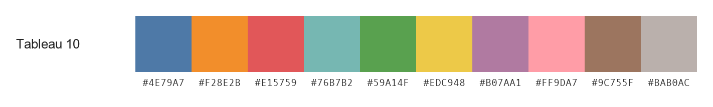
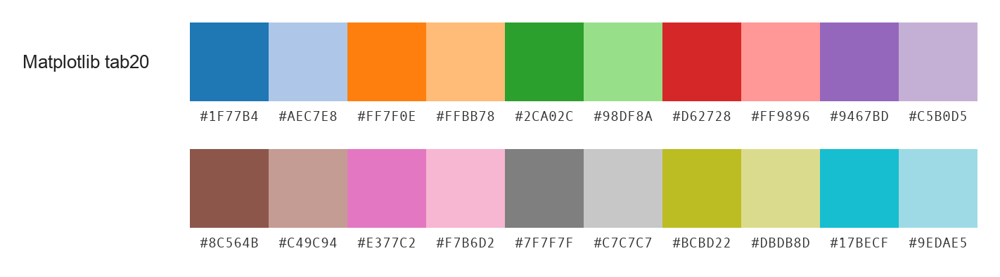
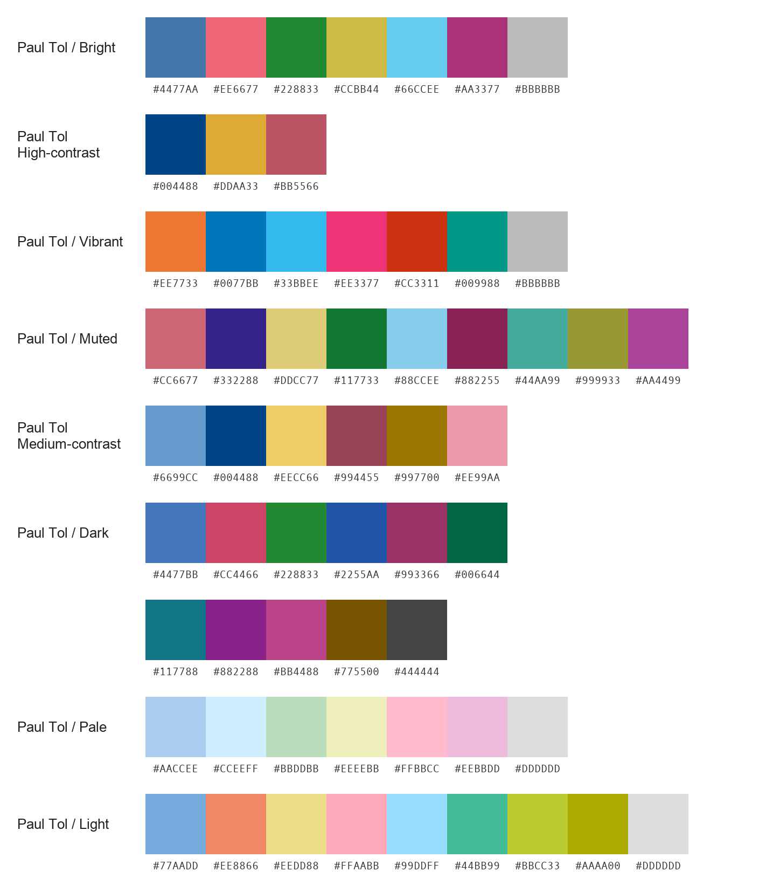
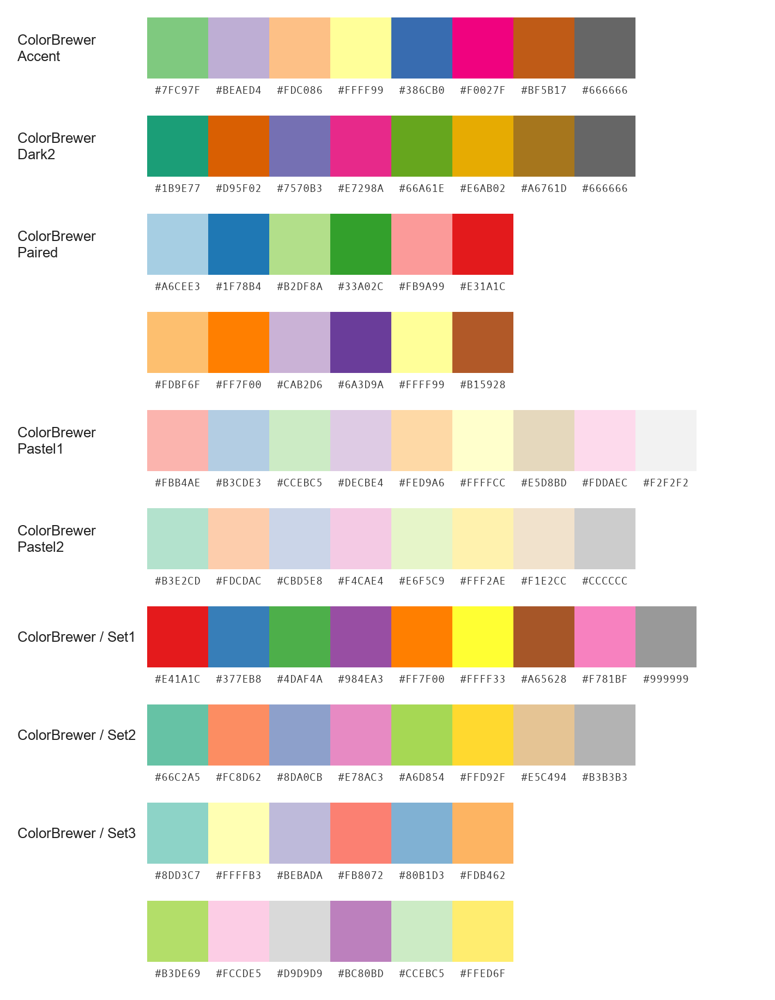

# カテゴリー変数のカラーパレット

「識別しやすい色を選ぶテクニック」の執筆時に調査した、カテゴリー変数（Qualitative data）向けの既存カラーパレットを掲載しています。

### Tableau 10

### Okabe–Ito

### Matplotlib tab20

### Paul Tol

### ColorBrewer

### 出典

- Tableau 10：[公式記事](https://www.tableau.com/blog/colors-upgrade-tableau-10-56782)・[HEX値（p. 9）](https://visxvision.com/wp-content/uploads/2017/11/stone-visxvision.pdf)
- Okabe–Ito：[岡部・伊藤の配色資料](https://jfly.uni-koeln.de/color/)
- Matplotlib tab20：[公式ソース](https://github.com/matplotlib/matplotlib/blob/v3.10.7/lib/matplotlib/_cm.py)
- Paul Tol：[本人の配色資料](https://sronpersonalpages.nl/~pault/)
- ColorBrewer：[公式サイト](https://colorbrewer2.org/)・[配色データ](https://colorbrewer2.org/export/colorbrewer.json)
